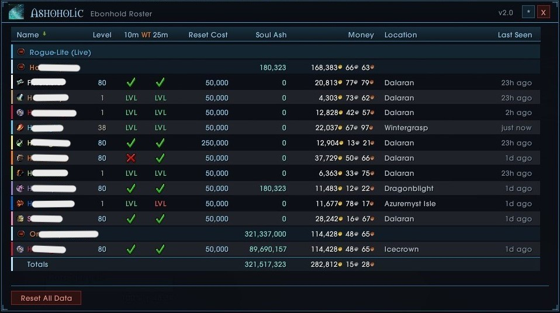
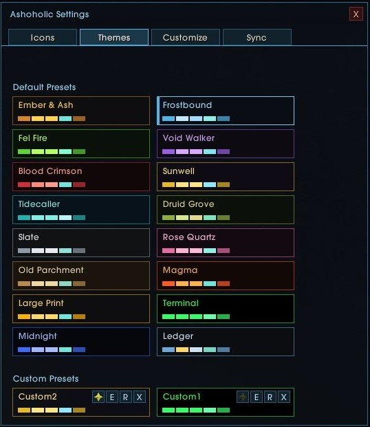
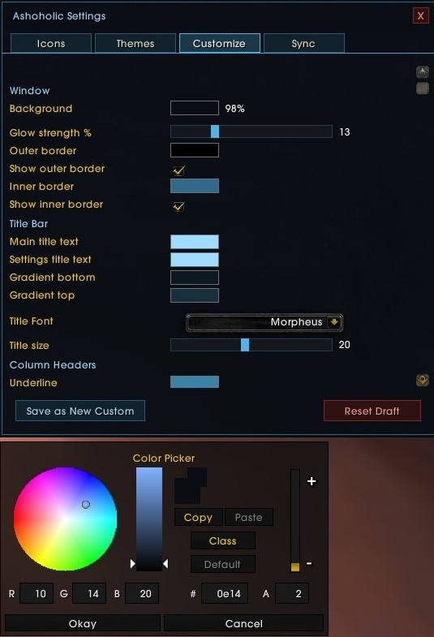
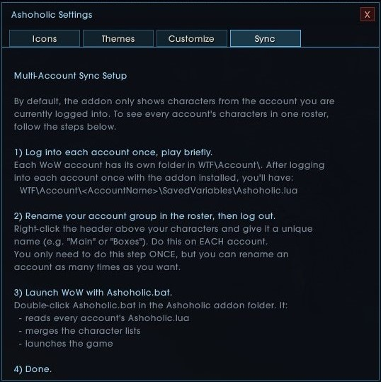

# 🍷 Ashoholic - Ebonhold Roster

**A highly customizable character, gold, and Soul Ash tracker for Project Ebonhold (WotLK 3.3.5).**

Tired of logging into 10 different alts just to check your gold, Soul Ash, or raid lockouts? Ashoholic gives you a beautiful, unified dashboard of your entire account's progress in one single window.

Whether you are a hardcore prestige grinder, an altoholic, or someone who multiboxes across multiple accounts, this addon was built for you.

## Special Thanks & Credits

Ashoholic was originally a fork of [Altoholic](https://www.wowace.com/projects/altoholic) by Thaoky, modified for Ebonhold by Crimson, with contributions and large UI overhaul courtesy of MarkusLastu.

## Key Features

*   **Comprehensive Character Tracking**
    *   **Soul Ash Breakdown:** Tracks your *Run*, *Unspent*, and *Committed* Soul Ash separately. Hover over the Soul Ash column to see a detailed breakdown.
    *   **World Tour Lockouts:** Instantly see if your characters are locked to 10-man or 25-man raids (Naxxramas, Obsidian Sanctum, Eye of Eternity) with clear icons and detailed tooltips.
    *   **Reset Costs & Gold:** Automatically scrapes your current Raid Reset Cost from the game client and tracks total gold across all characters.
    *   **Location & Last Seen:** Know exactly where you left your alts and how long ago you played them.
*   **Multi-Account Sync:** Includes custom PowerShell scripts to merge the SavedVariables of multiple WoW accounts before launch. See all your characters, across all your accounts, in one list.
*   **Fully Customizable UI:** 
    *   15+ built-in themes.
    *   Full RGBA color picker for every element.
    *   Font choices for the title, column headers, and roster row types. 
    *   Drag-and-drop column reordering and resizing.
    *   Save your own custom themes.
*   **Prestige Automation:** Hooks into the Ebonhold Prestige Service to automatically wipe your active Soul Ash tracking the moment you prestige.

## Screenshots

*The main dashboard with class-colored names, account grouping, and totals.*

*Pick between preset themes or customize your own, featuring full color pickers and opacity sliders.*

*The Sync tab, which explains how to set up multi-account merging.*

## Installation

1.  Download [Ashoholic.zip](https://github.com/CrimsonDC143C/Ashoholic/releases/latest/download/Ashoholic.zip) from the button above.
2.  Extract it into `Ebonhold\Interface\AddOns\`. The zip contains three addon folders: `Ashoholic`, `FastSwap`, and `SharedMedia`. Each has its own `.toc` file.
3.  Launch Ebonhold with `Ashoholic.bat` at least once to install the FastSwap character-selection hook. FastSwap will not switch characters until the hook has been synced. Launch with the batch file again after Ebonhold updates.
4.  Make sure you have the **ProjectEbonhold** addon enabled.
5.  Log in and type `/ash` or `/ashoholic`, or left-click on the minimap icon, to open the roster!

## Multi-Account Syncing (Optional)

If you play on multiple WoW accounts and want to see all your characters in one list:
1. Log into each account once and play briefly so the addon generates/updates the `SavedVariables/Ashoholic.lua` file for that account.
2. Locate the `Ashoholic.bat` file in the addon folder.
3. Use it to launch the game instead of `Wow.exe`. It will automatically merge all your account data before launching.

## Commands

*   `/ash` or `/ashoholic` - Toggles the main roster window.
*   `/ash config` or `/ashoholic config` - Opens the settings menu directly.

## Feedback & Issues

If you find any bugs, have feature requests, or want to share your custom themes, please open an **Issue** here on GitHub! 

**Hope you enjoy!** 
— ML
