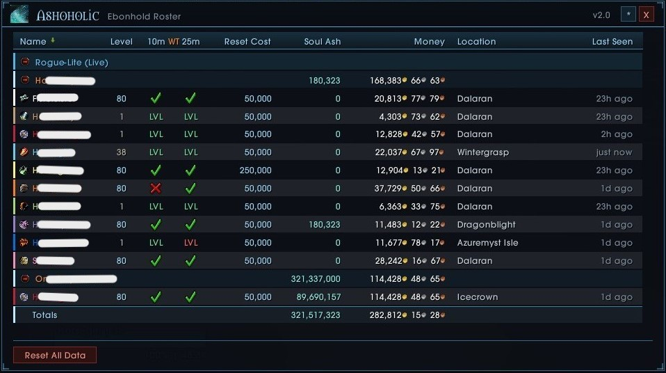
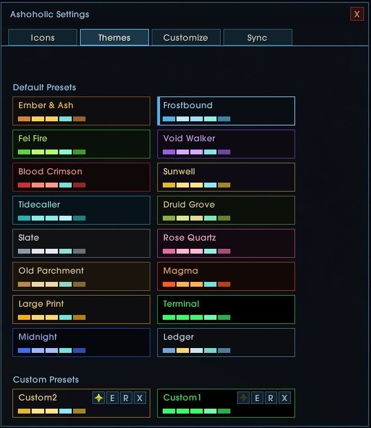
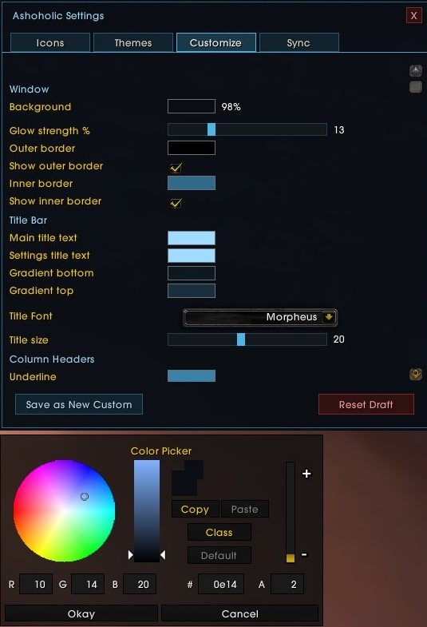
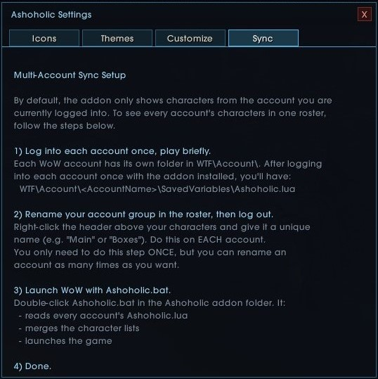

# 🍷 Ashoholic - Ebonhold Roster

The rolling PTR prerelease is refreshed automatically after successful pushes to `PTR-main`.

<!-- 

**A highly customizable character, gold, and Soul Ash tracker for Project Ebonhold (WotLK 3.3.5).**

Tired of logging into 10 different alts just to check your gold, Soul Ash, or raid lockouts? Ashoholic gives you a beautiful, unified dashboard of your entire account's progress in one single window.

Whether you are a hardcore prestige grinder, an altoholic, or someone who multiboxes across multiple accounts, this addon was built for you.

## Special Thanks & Credits

Ashoholic was originally a fork of [Altoholic](https://www.wowace.com/projects/altoholic) by Thaoky, modified for Ebonhold by Crimson, with contributions and large UI overhaul courtesy of MarkusLastu.

## Key Features

*   **Comprehensive Character Tracking**
    *   **Soul Ash Breakdown:** Tracks your *Run*, *Unspent*, and *Committed* Soul Ash separately. Hover over the Soul Ash column to see a detailed breakdown.
    *   **World Tour Lockouts:** Instantly see if your characters are locked to 10-man or 25-man raids (Naxxramas, Obsidian Sanctum, Eye of Eternity) with clear icons and detailed tooltips.
    *   **Reset Costs & Gold:** Automatically scrapes your current Raid Reset Cost from the game client and tracks total gold across all characters.
    *   **Location & Last Seen:** Know exactly where you left your alts and how long ago you played them.
*   **Multi-Account Sync:** Includes custom PowerShell scripts to merge the SavedVariables of multiple WoW accounts before launch. See all your characters, across all your accounts, in one list.
*   **Fully Customizable UI:** 
    *   15+ built-in themes.
    *   Full RGBA color picker for every element.
    *   Font choices for the title, column headers, and roster row types. 
    *   Drag-and-drop column reordering and resizing.
    *   Save your own custom themes.
*   **Prestige Automation:** Hooks into the Ebonhold Prestige Service to automatically wipe your active Soul Ash tracking the moment you prestige.

## Screenshots

*The main dashboard with class-colored names, account grouping, and totals.*

*Pick between preset themes or customize your own, featuring full color pickers and opacity sliders.*

*The Sync tab, which explains how to set up multi-account merging.*

## Installation

1.  Download [Ashoholic.zip](https://github.com/CrimsonDC143C/Ashoholic/releases/latest/download/Ashoholic.zip) from the button above.
2.  Extract it into `Ebonhold\Interface\AddOns\`. The zip contains three addon folders: `Ashoholic`, `FastSwap`, and `SharedMedia`. Each has its own `.toc` file.
3.  Launch Ebonhold with `Ashoholic.bat` at least once to install the FastSwap character-selection hook. FastSwap will not switch characters until the hook has been synced. Launch with the batch file again after Ebonhold updates.
4.  Make sure you have the **ProjectEbonhold** addon enabled.
5.  Log in and type `/ash` or `/ashoholic`, or left-click on the minimap icon, to open the roster! -->

<!-- ## Multi-Account Syncing (Optional)

If you play on multiple WoW accounts and want to see all your characters in one list:
1. Log into each account once and play briefly so the addon generates/updates the `SavedVariables/Ashoholic.lua` file for that account.
2. Locate the `Ashoholic.bat` file in the addon folder.
3. Use it to launch the game instead of `Wow.exe`. It will automatically merge all your account data before launching.
 -->
## Commands

### UI design preview

Use `/ash preview` for the separate, session-local design preview. All characters,
balances, activity objectives, timers and records are samples, not live tracking.
Account One contains ten sample characters for testing a fuller roster and raid matrix.
The preview window defaults to 1320 UI units wide. The currency cards and all
five tabs use the available width, including the raid matrix, Activities cards,
Progression panels and Trials columns.
The roster has space for its default columns and Swap buttons beside the
character details panel.
The header has no design-preview banner: tabs sit directly below the title,
followed by currency cards. All five tabs use the reclaimed height for their
lists and panels; Focus views retain their expanded space.
It scales down to fit smaller screens; extra columns and enlarged fonts can
still require horizontal scrolling.
Use **Focus roster** to temporarily hide the currency cards and show
compact, single-line roster rows. All ten Account One sample characters fit
without vertical scrolling at the default font and spacing. Account filtering,
sorting, column resizing, details and preview Swap remain available.
**Exit Focus** restores the normal header and your row-density settings.
Other tabs keep their normal layout; returning to Roster resumes Focus until
you exit it or reload. Larger fonts and custom row spacing can reduce capacity.
Closing preserves preview choices until `/reload`; it does not change your saved roster.
Hover the currency cards for explanations of their account-level totals.
Preview roster Swap buttons explain switching without logging out or passing
fictional character names to FastSwap.
Drag roster header edges to resize columns. Minimum widths fit each header and
the widest sample value across all accounts. Overflow scrolls horizontally;
widths follow their column when reordered and reset on `/reload`.
Right-click a header's resize handle to restore that column's default width,
still respecting the current font and content minimum.
Hold Shift while using the mouse wheel over the roster or its headers to scroll
sideways. Without Shift, the wheel scrolls vertically.
Settings > Roster Columns can enable all eleven optional columns, not just six.
Click roster headers to cycle ascending, descending, then unsorted. The first
column is primary; a second breaks ties. Selecting a third distinct column clears
both and starts a new primary sort. Header markers show direction and priority.
Sorting stays within account groups, keeps unknown values last, and returns to
sample order when cleared. Hiding a column removes its sort.
In Raids & Dungeons, hide the tracking-selection sidebar to make room for twelve
compact character columns without widening the main window. Wider columns and
horizontal scrolling remain available for larger selections.
**Focus encounters** reclaims header and currency-card space for a taller
encounter matrix and tracking picker. **Exit Focus** restores their normal
heights. Watchlist, collapsed groups, account filters and column choices are
preserved; roster and encounter Focus choices are independent and last until
reload. Other tabs retain their normal header.
Watched raid headings show Normal loot item level and release metadata when
provided by ProjectEbonhold's catalogue. These describe the raid, not a
character's queue eligibility; no live requests or release filtering are added.
Click the watched matrix's Raids or Dungeons section header to collapse its
instances and bosses without changing the watchlist.
Activities uses the full width for one account, separating Daily and Weekly
examples; multiple accounts retain a two-column overview. Reset times and
objectives are explicitly illustrative, not live server data.
Progression estimates sample Prestige Essence using the sample account's
Prestige count, the increasing Shards-per-Essence rate, and the early-Prestige
consumption cap. It does not read your real Prestige data.
Themes separates read-only Default Presets from Custom Presets. Custom presets
can be saved, applied, starred, renamed, edited and deleted; they capture colors,
fonts, icons and row layout, but not account filters. They last until `/reload`
and never replace the live addon's saved themes.
Closing Settings with edited theme colors, fonts, icons or layout prompts to save
as a new custom preset, discard changes, or continue editing. Applied custom
presets also offer Update current. New-preset names are focused and selected
automatically. Saving closes Settings; cancelling the name popup keeps the draft.
Discard restores the appearance from the last applied or saved preset.
Customize Theme combines colors, typography and layout in one scrolling editor,
with Colors, Fonts and Layout jump buttons and shared Save/Update controls.
It offers independent title/header, row/account, button and tab
colors, including odd/even rows, hover and selection. Change opens the same live
color-and-opacity picker used by the old Settings; Cancel restores the original
color and alpha. Hex accepts exact RGB or RGBA values.
Scroll or use the jump buttons for per-role fonts and size adjustments, row height,
spacing and border thickness. Save as new or update an applied custom preset.
Class-name colors and loot-status colors intentionally retain their meaning.

Developer check: `lua tools\test_preview_ui.lua` exercises the preview with mocked
WoW widgets, including resize minimums, all columns, twelve populated raid columns,
full-width tabs, ten fully fitting Focus roster rows, Focus restoration,
sample Prestige estimates, account filtering, encounter collapsing and custom
preset save/restore.
This does not validate game-client rendering or real server behavior.

<!-- *   `/ash` or `/ashoholic` - Toggles the main roster window.
*   `/ash config` or `/ashoholic config` - Opens the settings menu directly.
*   `/ash memory` - Collects Lua garbage and reports addon memory before and after collection. Run between repeated test batches to check whether retained memory keeps growing; this does not measure the game client's native memory or font cache.
 -->
## Feedback & Issues

If you find any bugs, have feature requests, or want to share your custom themes, please open an **Issue** here on GitHub! 

**Hope you enjoy!** 
— ML
