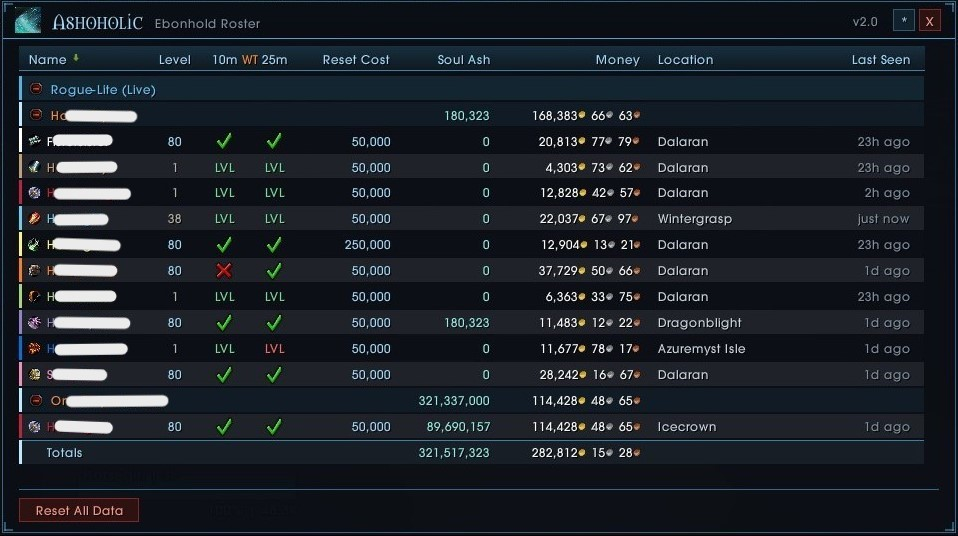
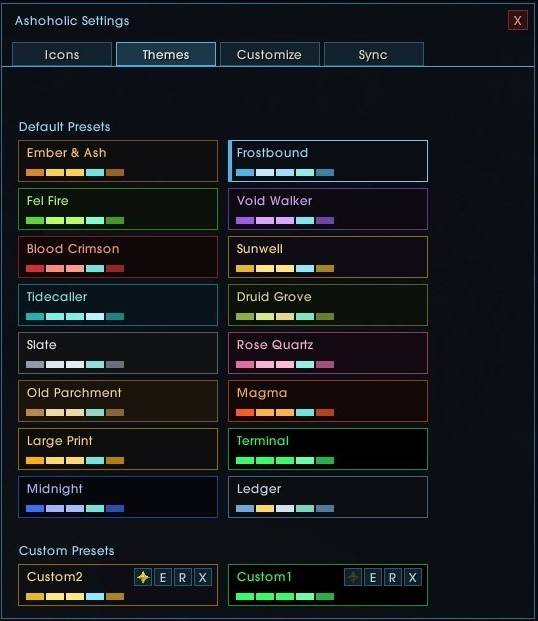
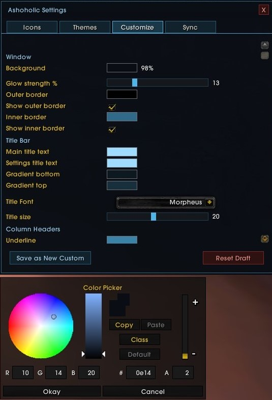
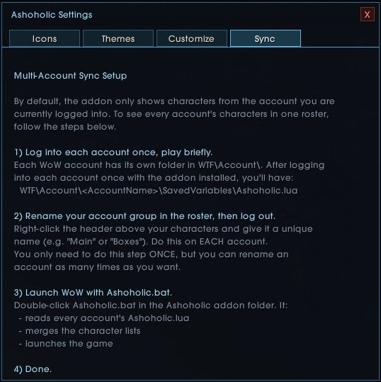

# 🍷 Ashoholic - Ebonhold Roster

[](https://github.com/CrimsonDC143C/Ashoholic/releases/download/ptr-latest/Ashoholic-PTR.zip)

The rolling PTR prerelease is refreshed automatically after successful pushes to `PTR-main`.

<!-- [](https://github.com/CrimsonDC143C/Ashoholic/releases/latest/download/Ashoholic.zip)

**A highly customizable character, gold, and Soul Ash tracker for Project Ebonhold (WotLK 3.3.5).**

Tired of logging into 10 different alts just to check your gold, Soul Ash, or raid lockouts? Ashoholic gives you a beautiful, unified dashboard of your entire account's progress in one single window.

Whether you are a hardcore prestige grinder, an altoholic, or someone who multiboxes across multiple accounts, this addon was built for you.

## Special Thanks & Credits

Ashoholic was originally a fork of [Altoholic](https://www.wowace.com/projects/altoholic) by Thaoky, modified for Ebonhold by Crimson, with contributions and large UI overhaul courtesy of MarkusLastu.

## Key Features

*   **Comprehensive Character Tracking**
    *   **Soul Ash Breakdown:** Tracks your *Run*, *Unspent*, and *Committed* Soul Ash separately. Hover over the Soul Ash column to see a detailed breakdown.
    *   **World Tour Lockouts:** Instantly see if your characters are locked to 10-man or 25-man raids (Naxxramas, Obsidian Sanctum, Eye of Eternity) with clear icons and detailed tooltips.
    *   **Reset Costs & Gold:** Automatically scrapes your current Raid Reset Cost from the game client and tracks total gold across all characters.
    *   **Location & Last Seen:** Know exactly where you left your alts and how long ago you played them.
*   **Multi-Account Sync:** Includes custom PowerShell scripts to merge the SavedVariables of multiple WoW accounts before launch. See all your characters, across all your accounts, in one list.
*   **Fully Customizable UI:** 
    *   15+ built-in themes.
    *   Full RGBA color picker for every element.
    *   Font choices for the title, column headers, and roster row types. 
    *   Drag-and-drop column reordering and resizing.
    *   Save your own custom themes.
*   **Prestige Automation:** Hooks into the Ebonhold Prestige Service to automatically wipe your active Soul Ash tracking the moment you prestige.

## Screenshots



*The main dashboard with class-colored names, account grouping, and totals.*




*Pick between preset themes or customize your own, featuring full color pickers and opacity sliders.*



*The Sync tab, which explains how to set up multi-account merging.*

## Installation

1.  Download [Ashoholic.zip](https://github.com/CrimsonDC143C/Ashoholic/releases/latest/download/Ashoholic.zip) from the button above.
2.  Extract it into `Ebonhold\Interface\AddOns\`. The zip contains three addon folders: `Ashoholic`, `FastSwap`, and `SharedMedia`. Each has its own `.toc` file.
3.  Launch Ebonhold with `Ashoholic.bat` at least once to install the FastSwap character-selection hook. FastSwap will not switch characters until the hook has been synced. Launch with the batch file again after Ebonhold updates.
4.  Make sure you have the **ProjectEbonhold** addon enabled.
5.  Log in and type `/ash` or `/ashoholic`, or left-click on the minimap icon, to open the roster! -->

<!-- ## Multi-Account Syncing (Optional)

If you play on multiple WoW accounts and want to see all your characters in one list:
1. Log into each account once and play briefly so the addon generates/updates the `SavedVariables/Ashoholic.lua` file for that account.
2. Locate the `Ashoholic.bat` file in the addon folder.
3. Use it to launch the game instead of `Wow.exe`. It will automatically merge all your account data before launching.
 -->
## Commands

### Live roster, raids and progression

Use `/ash` or `/ashoholic` to open the live window.

- **Roster:** saved character basics, run Ash/Shards, and spendable account
  currency cards. Equipped item level comes from the latest Call Board reply,
  so it remains Unknown until observed and may be stale after a gear change.
  Click a character for its parked-run details: offering bonus,
  offerings remaining this run, Soul Anchor, active live Echo loadout, and
  selected/highest unlocked Torment. Hover a detail row for its source and age.
- **Progression:** account-wide Torment unlock ladders,
  alongside account Prestige count, committed Ash progress, and the next
  server-reported Essence reward. Access is shared by all characters on the
  account; selected difficulty remains character-specific. Higher,
  instance-only Torments retain their actual names rather than being capped at X.
- **Raids & Dungeons:** select encounters in the watchlist to compare saved
  characters. Raid names, boss IDs and loot metadata come from
  ProjectEbonhold's catalogue. **Looted** means the character has an active
  boss loot lock; it does not prevent entering the raid. **Available** means
  no active loot lock was reported, not that the raid is accessible. Hover a
  status for its observation age and, when looted, remaining lock time.
  Selection is saved across reloads. Dungeon names come from Ashoholic's
  catalogue; **Tracked** means a planning/watchlist reference only, not a kill,
  loot, completion, accessibility or weekly-lockout claim.
- **Activities:** the latest Hero's Call Board snapshots, rewards and reset
  times, with shared objectives displayed once per account. Open the Call Board
  on each character to collect them. Cache progress and the weekly reward rail
  are per character; paid claims show their cost. Old daily or weekly objectives
  are marked as needing a fresh board after their reset.
- **Trials:** saved Champion and Crusader bests, ranks and their independent
  observation ages. Open the relevant companion leaderboard or complete a
  ranked Trial to update a record. Practice runs are excluded. Team size stays
  Unknown if the companion did not provide an unambiguous value.
- **Freshness:** run currencies, offerings/anchor, Echo builds, Torment,
  Prestige and raid loot keep independent timestamps. Offline characters
  retain their last observations; missing observations display **Unknown**,
  not zero. Raid locks become available when their reported end times pass.

Ashoholic observes the companion's normal updates. The companion requests
Prestige, Torment and contracts on entering the world, and requests Echo slots
after its active-slot update. Opening the companion's Prestige panel obtains a
fresh Prestige reply; the live **Refresh** button only redraws saved snapshots.
The existing once-per-session currency request on opening `/ash` is unchanged.
Raid loot updates normally arrive at login and after a new lock; Ashoholic does
not request them. Open the game's **Raid Info** on a character to ask the
companion for a fresh update if necessary. No Prestige, offering, anchor,
difficulty or build-switch actions are performed by Ashoholic.

The Soul Anchor display uses its saved place, not the Spirit Healer's relative
"here/elsewhere" wording. **Echo build** means the active live loadout, not a
highlighted wishlist. Prestige rewards come from a complete server snapshot;
older replies without reward fields leave those values Unknown.

Schema version 7 preserves existing data and moves the previous window options
to their new location. Warband bank gold is account-wide and remains Unknown
until an extended-bank update reports it. Torment access accumulates observed
unlocks without inventing lower tiers.
Optional Call Board, Trial and sync data fill only after their sources are
observed or imported.

### Live settings and integrations

Open **Settings** in the live window or use `/ash settings`. Themes, custom
presets, colors/alpha, fonts, density, spacing,
icons, resizable/reordered columns, two-key sorting, tabs, account colors and
collapse preferences are saved locally. Use Shift + mouse wheel to scroll
wide roster columns. Account filters exclude hidden accounts from all live
pages and currency/gold totals. The current character is selected on first
opening each session; later clicks keep their selection.

**Tabs & Views** also controls login opening, combat hiding, position locking
and Escape behavior. **Alerts** supports chat, center-screen or silent tab
badges from saved cache/Prestige readiness, watched raid loot, server-reported
lock expiry and snapshots at least seven days old. These are reminders from
saved evidence, not live guarantees about offline characters.

**Profiles & Sharing** creates, selects, copies and deletes local profiles,
assigned to this character or this account. Changes save automatically.
Export/import `ASHT1:` theme strings to share appearance; account-data sync
intentionally does not copy profiles or other UI preferences.

The minimap icon opens the roster; right-drag it to move it. **Swap** calls the
separate FastSwap addon only for another character on the current account and
realm. FastSwap's own character-selection hook lives in `ebonhold_glue.lua` in
the game folder. **Ebonhold launcher updates replace that file with a stock
copy, which silently removes the hook**: Swap then logs out but does not pick
the character. To restore it, close WoW and run `.\Sync-FastSwapGlue.ps1 -Force`
from the installed `Interface\AddOns\FastSwap` folder (the game folder is found
automatically; `-GameRoot` is optional). `-InstallTask` points the Ebonhold
shortcuts at a watcher that re-syncs automatically whenever `ebonhold.dll` or
`ebonhold_glue.lua` changes. The hook waits for the requested name while the
character list finishes loading.
If Nexus is enabled, its Character Roster tab opens the live roster
beside its panel; drag the roster to detach it.

### Sharing accounts in game

Both WoW accounts must be online with the same Ashoholic schema version. On
**each** account, open Settings and enter the other online character's name
under trusted sync; click **Trust**. Use `Character-Realm` when necessary (realm
spaces are removed); a plain character name means the current realm. Same-realm
whispers use bare names, including peers previously saved with a realm suffix.
Then click
**Sync** for that peer or **Sync all**. The chat reports sending, receiving,
confirmation or errors; keep both characters online until both directions have
finished.

Equivalent commands are `/ash sync trust Character`, `/ash sync remove Character`,
`/ash sync list`, `/ash sync Character` and `/ash sync all`. Trust is local and
must be configured on both accounts. The game-provided whisper sender is the
trust boundary; this is not cryptographic authentication. Only the current
account's snapshots are shared, not settings, saved copies of other accounts,
or account aliases. Imported accounts receive a neutral alias that can be
renamed locally. Transfers are chunked and throttled and use a compact text
format (sync protocol 2; both installations need this version). Large
accounts with many Call Board activities can still take a few minutes. An
account snapshot over 256 KiB is rejected rather than partially imported. If
one side cannot prepare its snapshot, it tells the requesting character instead
of letting it wait silently. Each group retains its
original observation time, and an older group never overwrites a newer one.
Keep the computers' clocks reasonably synchronized, since freshness comparisons
use their wall-clock times.

### Offline account merge

This is separate from the FastSwap installation helper:

1. Install the same Ashoholic version, log into each account at least once, and
   log out normally so each account writes an offline export.
2. Close all WoW and Ebonhold game/launcher processes. In PowerShell, run the
   script from the installed addon, adjusting the path to your game folder:

   ```powershell
   powershell -NoProfile -ExecutionPolicy Bypass -File "C:\Games\Ebonhold\Interface\AddOns\Ashoholic\OfflineMerge.ps1" -GameRoot "C:\Games\Ebonhold"
   ```

3. Log into each account to import the prepared snapshots. Repeat the process
   after collecting newer data. The script warns about accounts without an
   export, backs up source saves under `WTF\AshoholicBackups`, and never edits
   those saves. It replaces the installed addon's `Sync\OfflineInbox.lua`; keep
   that generated file private and do not commit it. The addon validates and
   merges its contents through the same data API used for in-game sync.

### Developer checks

`lua tools\test_live_dashboard.lua`, `lua tools\test_live_raids.lua` and
`lua tools\test_data_layer.lua` exercise live UI and data paths with mocked WoW
APIs. They do not validate rendering or server behavior in the game client.
The original design preview is archived as reference only and is not included
in the addon.

<!-- *   `/ash` or `/ashoholic` - Toggles the main roster window.
*   `/ash config` or `/ashoholic config` - Opens the settings menu directly.
*   `/ash memory` - Collects Lua garbage and reports addon memory before and after collection. Run between repeated test batches to check whether retained memory keeps growing; this does not measure the game client's native memory or font cache.
 -->
## Feedback & Issues

If you find any bugs, have feature requests, or want to share your custom themes, please open an **Issue** here on GitHub! 

**Hope you enjoy!** 
— ML
